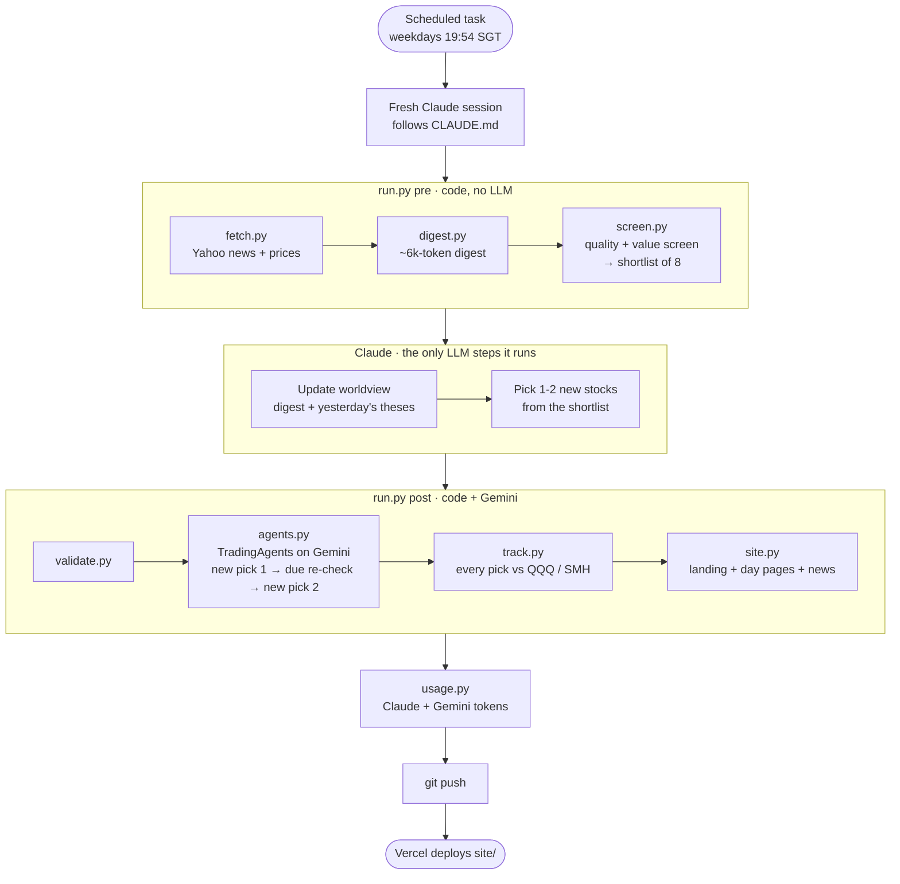
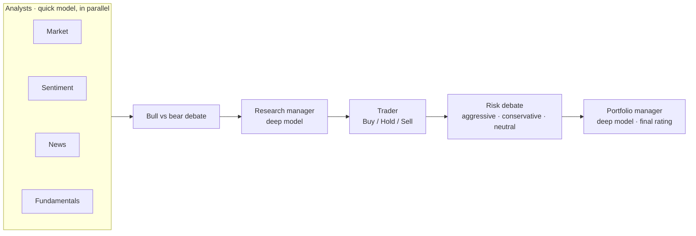

# gene-research

A daily, mostly automated research diary on the AI build-out. Every weekday at 20:00 Singapore time (8am New York, before the US open) it:

1. **Fetches** news and prices for ~70 AI-bottleneck stocks from Yahoo Finance (code).
2. **Digests** them into one short file grouped by segment (code).
3. **Updates a worldview**: a list of theses with confidence levels, carried forward and revised daily (Claude).
4. **Screens** the universe for financial quality and value, skipping recent picks (code).
5. **Picks** 1-2 new stocks from the shortlist (Claude). Every pick joins the watchlist.
6. **Verifies** them with [TradingAgents](https://github.com/TauricResearch/TradingAgents), a multi-agent analyst team running on Gemini, and re-checks one watchlist name a day. A name is dropped after two negative ratings or three Holds in a row.
7. **Tracks** every past pick against QQQ and SMH, grades ratings after 28 days, and compares the picks with no-AI alternatives (the screen's #1, a random shortlist name, the whole universe) to show whether the AI steps add anything (code).
8. **Publishes** a static site from `site/` (code, deployed by Vercel).

House style: Situational Awareness for direction (AI's bottlenecks: compute, power, grid, cooling, data centres and their suppliers), Buffett for selection (real cash flow, low debt, a price that limits the downside).

## How a daily run is orchestrated

Two levels. A scheduled Claude session is the top-level orchestrator: it runs the code stages, does the two thinking steps itself, and hands verification to TradingAgents, a second multi-agent system running on Gemini. Everything that can be code is code, so Claude only reads three short files a day.



Inside `agents.py`, each stock goes through TradingAgents' own team:



| Step | Who | LLM tokens |
|---|---|---|
| Fetch, digest, screen, validate, track, build site | Python | none |
| Worldview, picks, monthly review | Claude (scheduled session) | ~2-3M cache read, ~13k out per run |
| Stock verification and watchlist re-checks | TradingAgents on Gemini | ~35 calls, ~150k tokens per run |

## Layout

| Path | What it is |
|---|---|
| `universe.json` | The tickers by segment. Edit to change what gets screened. |
| `pipeline/` | One script per stage; `run.py pre` and `run.py post` chain them. |
| `CLAUDE.md` | The runbook the daily Claude session follows. |
| `data/<date>/` | Each day's raw news (`news.jsonl`, every article pulled), digest, shortlist, picks and TradingAgents output. |
| `data/worldview/<date>.json` | The worldview as of that day. |
| `data/picks.csv` | Ledger of every pick and re-check, with prices at the time. |
| `data/watchlist.json` | Every stock under watch, its rating history and why any were dropped. |
| `data/tracking.json` | Every pick marked to market, plus the rating scorecard. |
| `data/usage.csv` | Claude and Gemini tokens used by each daily run (also shown on the site). |
| `plan.json` | Your Claude plan and the measured share of its weekly limit one run uses (fill in once; see the file). |
| `data/ta_memory/` | TradingAgents' memory of past decisions, kept between runs. |
| `site/` | The generated website: `index.html` (overview), `days/<date>.html` (in-depth) and `news/<date>.json` (articles for the news archive). |
| `.claude/settings.json` | A hook that reminds you, on every prompt, which data sources the cloud network still blocks. |

## Run it by hand

```bash
bash scripts/setup.sh
.venv/bin/python pipeline/run.py pre      # then write the worldview and picks (see CLAUDE.md)
.venv/bin/python pipeline/run.py post --max 2
```

Needs `GOOGLE_API_KEY` for TradingAgents. `RUN_DATE=YYYY-MM-DD` reruns a past date.

An experiment, not financial advice. Model output can be wrong.
